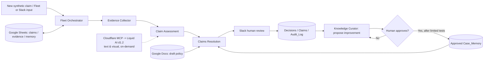

# ClaimFlow AI — DTU Applied AI for Entrepreneurs

**Project status (26 November 2026): Integrated Fleet prototype tested through the human-review request; follow-up ingestion and final Fleet export remain pending.**

ClaimFlow AI is a **human-supervised, multi-agent assistant for synthetic logistics claims** (damage, delay and loss). The project combines LangSmith Fleet agents, the Liquid AI d1.2 System One decision model (including a controlled visual assessment), versioned draft policy checks, Slack human review, Google Sheets operational records, and a supervised Knowledge Factory.

> **Academic demonstration only:** No real customer claims, verified physical damage, production carrier rules or compensation decisions. Source-backed observations and model suggestions are not settlement authority.

## Demonstrated components

- **Fleet Orchestrator + four subagents:** `evidence-collector`, `claim-assessment`, `claim-resolution` (called **Claims Resolution** in the project narrative), and `knowledge-curator`.
- **Google Sheets:** operational case, shipment, evidence, decision, approved memory, improvement flag and audit records; verified reads/writes. The native Google Sheet, **not an imported Excel file**, is required for the Sheets API.
- **Google Docs:** retrieved the `demo-v0.1` draft claims-policy document.
- **Slack:** Fleet posted a `CLM-0004` recommendation to `#claimflow-demo`; the human replied in the thread approving **evidence collection only**. Ingestion of that reply into the decision ledger is **not yet tested**.
- **Cloudflare Worker custom MCP + Liquid AI d1.2:** real text-only System One and separate visual inference (`CLM-VIS-001`, `EV-VIS-001`) tested. Visual sample was an **unverified internet photograph** and is deliberately excluded from this repository.
- **Knowledge Factory:** verified `KFL-0001` -> human-approved `MEM-0001` rev `0.2`, stored in Google Sheets; later `claims-resolution` used the retrieved memory while processing a **new** synthetic case, `CLM-0004`.
- **Schedule:** `ClaimFlow - Pending Evidence Monitor`, Mondays at 09:00 browser-local time, **configured but PAUSED and not execution-tested** to conserve Fleet credits.
- **End-to-end integration:** `CLM-0004` / `SHP-1004` reached Slack human review, updated `Claims.proposed_action` to `request_more_evidence`, preserved `approval_decision=pending`, and appended verified audit record `AUD-0006`. No external System One call occurred during that run (separately tested earlier).

Read the detailed status and evidence inventory in [`docs/implementation-status.md`](docs/implementation-status.md). The **Fleet export itself has not yet been downloaded or reviewed**; repository skill files are contributor drafts, not the native Fleet export.

## Process flow

**Important:** this diagram illustrates the *intended whole lifecycle*. The Slack operator reply was observed, but its downstream ingestion and final status update remain to be demonstrated. Schedules are paused. No compensation automation exists.

## Repository guide

| Path | Purpose |
| --- | --- |
| [`docs/architecture.md`](docs/architecture.md) | As-built architecture and remaining boundaries |
| [`docs/data-contract.md`](docs/data-contract.md) | Shared conceptual contract and observed Sheets schemas |
| [`docs/integrations-and-deployment.md`](docs/integrations-and-deployment.md) | Connections, Worker, KV, permissions and safe deployment |
| [`docs/implementation-status.md`](docs/implementation-status.md) | Evidence-based implementation status |
| [`docs/demo-script.md`](docs/demo-script.md) | Low-credit, accurate demo narration and pending checks |
| [`tests/results/2026-11-26-fleet-verified.md`](tests/results/2026-11-26-fleet-verified.md) | Observed integration-test results and limits |
| [`worker/`](worker/) | Reviewed copy of deployed-style Cloudflare MCP Worker source, **no credentials or third-party image** |
| [`skills/`](skills/) | Team-maintained skill drafts, **not automatically deployed to Fleet** |
| [`fleet/`](fleet/) | Destination for the verified Fleet ZIP after it is actually exported |
| [`docs/reference/`](docs/reference/) | Project context and original team role/deadline plan |
| [`pitch/`](pitch/) and [`one-pagers/`](one-pagers/) | Group deliverables |

## Collaboration and deadlines

Read `docs/reference/ClaimFlow_AI_Team_Work_Plan.pdf`, keep work on feature branches and submit pull requests. The six team roles and task ownership in that document are unchanged. GitHub and Slack invitations are separate from Fleet/Google account permissions; **never share account passwords**.

- **Official submission deadline: Sunday 6 December 2026** (confirm the platform's exact cutoff time).
- Required Fleet items per lecturer: `AGENTS.md`, `config.json`, `SKILL.md`, `tools.json` **from the real Fleet export**, plus the PDF pitch deck and six article-connected individual one-pagers. Do not confuse this repository's `AGENTS.md` or `skills/*/SKILL.md` with exported Fleet artefacts.

## Privacy and reproducibility

This repository is currently **public**: consider changing it to **private** before publishing operational metadata or allowing collaborators to add screenshots. Never commit API keys, OAuth tokens, MCP bearer tokens, `.dev.vars`, credential-bearing exports, real customer data, or the third-party visual demo image. The external worker, KV image, live Sheets/Docs and Slack resources are **not recreated automatically by downloading the Fleet ZIP**.
